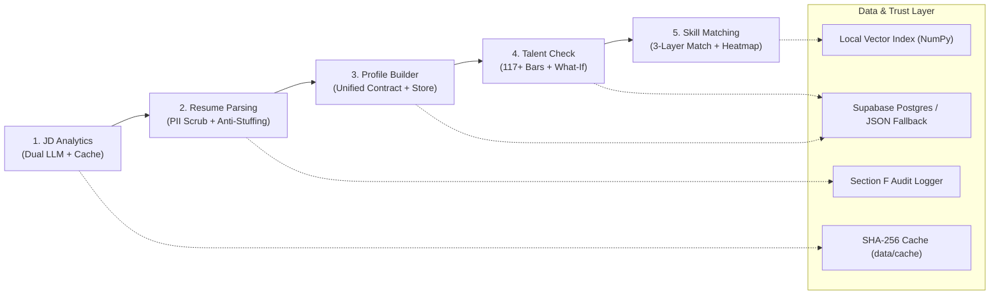

# GapMap: Evidence-Driven ATS & Skill Gap Intelligence Engine

> **RADIX Talent Match Hackathon** | Team Lead: **Aarush**  
> **Tagline**: *Know your gap. Prove your skills.*  
> **Status**: ✅ **135/135 Pytest Tests Passing** • **Zero TypeScript Build Errors** • **Docker Ready**

---

[](https://github.com/aarushgoel025/GapMap)
[](https://www.python.org/)
[](https://fastapi.tiangolo.com/)
[](https://react.dev/)
[](https://www.typescriptlang.org/)
[](https://tailwindcss.com/)
[](https://ai.google.dev/)
[](https://supabase.com/)

---

## 🎯 Executive Summary & The Problem We Solve

Traditional Applicant Tracking Systems (ATS) rely on shallow keyword matching. This creates two massive systemic failures in recruitment:
1. **The Keyword Lottery**: 75% of qualified applicants are rejected simply because they use industry-standard synonyms (e.g., writing *Networking* instead of *Computer Networks*, or *PostgreSQL* instead of *SQL*).
2. **The Keyword Stuffing Cheat**: Candidates game keyword filters by copy-pasting 50+ technical buzzwords into their "Skills" section without having ever written a single line of code in them.
3. **The Black Box**: Rejected candidates receive generic rejection emails with zero explainability on their competency gaps or how to achieve placement readiness.

**GapMap** solves this by re-engineering ATS into an **evidence-based talent verification and gap intelligence engine**. It extracts quote-backed skills, detects keyword stuffing using strict word-boundary analysis, benchmarks candidates against **117+ corporate hiring bars**, simulates skill growth live via an interactive **What-If Simulator**, and generates explainable **3-layer matching** with prerequisite-ranked learning graphs.

---

## 💎 The Four Pillars (Our USPs — What Makes Us Stand Out)

> *"Most teams will build: upload resume, get an ATS score, see missing keywords. Public GitHub projects already do this (SkillBridge, Resumizer, ResumeMatch AI). That will not make us stand out. We stand out with Four Architectural Pillars."*

```
                     ┌─────────────────────────────────────────────────────────┐
                     │                       GAPMAP ENGINE                     │
                     └────────────────────────────┬────────────────────────────┘
                                                  │
         ┌─────────────────────────┬──────────────┴──────────────┬─────────────────────────┐
         ▼                         ▼                             ▼                         ▼
   ┌───────────┐             ┌───────────┐                 ┌───────────┐             ┌───────────┐
   │ PILLAR 1  │             │ PILLAR 2  │                 │ PILLAR 3  │             │ PILLAR 4  │
   │  Proof-   │             │  What-If  │                 │  3-Layer  │             │Trustworthy│
   │  Backed   │             │ Simulator │                 │  Matching │             │AI Pipeline│
   │  Skills   │             │  & Gaps   │                 │  Engine   │             │ (Consensus│
   └───────────┘             └───────────┘                 └───────────┘             └───────────┘
   "Do not claim             12-Domain Bar                  Exact 1.0                 Gemini +
    it. Prove it"             What-If Sliders               Alias 0.9                 Mistral Dual
    Quote evidence            Prereq-First                  Semantic 0.8              135 Pytest
    Anti-Stuffing             Weeks to Ready                4x6 Heatmap               Audit Trail
```

### 🛡️ Pillar 1: Proof-Backed Skills (Evidence Engine)
- **Demo Punchline**: *"Do not just claim it. Prove it."*
- **Verbatim Evidence Linking**: Every extracted skill is bound to an exact quote from the candidate's resume or project work, accompanied by a verified confidence rating (`high`, `medium`, `low`).
- **Word-Boundary Keyword Stuffing Detector**: Scans resume section boundaries. If a skill appears in the "Skills" section but is never mentioned in "Experience" or "Projects", GapMap flags `stuffing_flag = True`, demotes confidence by one tier, and surfaces an alert warning to recruiters.
- **Opt-in GitHub Verification**: With explicit user checkbox consent, queries candidate's top repositories to verify real languages and commit topics, appending `github` to `verified_by`.

### 🎛️ Pillar 2: What-If Simulator & Impact-Ranked Gap Plan
- **Standardized 12-Category Hiring Bars**: Benchmarks candidates against **117 corporate hiring bars** (Google, Microsoft, Oracle, Amazon, Apple, etc.) across 12 standardized categories (`COD`, `DSA`, `OOD`, `APTI`, `COMM`, `AI`, `CLOUD`, `SQL`, `SWE`, `SYSD`, `NETW`, `OS`).
- **Interactive What-If Sliders**: Drag category levels (0–10) live (e.g., *"What if my Databases & SQL skill reached Level 8?"*) to see immediate readiness score recalculation, category contribution, and gap-closing point deltas.
- **Weeks-to-Placement Estimate**: Automatically calculates preparation time (e.g., *"14 weeks intensive preparation to meet Google hiring bar"*).
- **Prerequisite-First Learning Graph**: Unmet skills are sorted by dependencies first (e.g., learn *Linux* $\to$ *Docker* $\to$ *Kubernetes*), skipping prerequisites the candidate already possesses.

### 🧠 Pillar 3: Smarter Matching in 3 Layers (SkillBridge-Style)
- **Layer 1: Exact Match (Credit: 1.0)** — Normalized string equivalence (`normalize_name` lowercases, strips whitespace, hyphens, and dots: `Node.js` $\equiv$ `nodejs`).
- **Layer 2: Alias / Family Match (Credit: 0.9)** — Technical synonym taxonomy via `aliases.json` (`Networking` $\leftrightarrow$ `Computer Networks`, `ReactJS` $\leftrightarrow$ `React`, `Microservices` $\leftrightarrow$ `System Design`, `PostgreSQL` $\leftrightarrow$ `SQL`).
- **Layer 3: Semantic Match (Credit: 0.8 × Cosine)** — In-memory vector embeddings with cosine similarity ($\ge 0.55$) for related conceptual competencies.
- **Explainable Tagging**: Every matched skill badge clearly indicates which layer confirmed it.
- **4×6 Differentiation Heatmap Matrix**: Proves candidates score differently across diverse roles (e.g., Alex Chen scores 83.3% on Microsoft Full Stack, but 40.8% on Google Cloud Architect).

### 🤝 Pillar 4: Trustworthy AI Pipeline (What Talencia Taught Us)
- **Dual-LLM Parallel Consensus**: Queries Google Gemini 2.5 and Mistral AI simultaneously using `ThreadPoolExecutor`. Consensual skills are tagged `models_agree = True`; category disputes are logged in `extras.disagreements`.
- **Fault-Tolerant Pydantic Contracts**: Strict validation on all inputs/outputs with an automated 3-retry self-correction loop that reflects validation error traces back to the model.
- **SHA-256 Content-Addressed Caching**: Instantaneous offline demo execution with zero API latency.
- **100% Test Automation**: 135 automated unit and integration tests passing in ~7.3 seconds.

---

## 🏛️ Implementation of the 8 Talencia Global Systems

| # | Talencia System | Architectural Goal | GapMap Codebase Implementation | Verified Status |
| :-: | :--- | :--- | :--- | :---: |
| **01** | **Parameter Discovery** | Unified 12-Skill Taxonomy | Enforced across all Pydantic schemas (`COD`, `DSA`, `OOD`, `APTI`, `COMM`, `AI`, `CLOUD`, `SQL`, `SWE`, `SYSD`, `NETW`, `OS` + `OTHER`) and 117+ corporate hiring bars in `talent_check_company_skillsets.json`. | ✅ Complete |
| **02** | **Database Normalization** | 3NF Relational Persistence | Relational Supabase PostgreSQL schema (`profiles`, `profile_skills`, `jd_documents`, `talent_check_runs`, `audit_log`) with seamless zero-config local JSON fallback in `backend/data/` for offline resilience. | ✅ Complete |
| **03** | **Test Automation** | Metadata-Driven Verification | **135 automated pytest tests** covering dual-model consensus, caching mechanics, PII masking, anti-stuffing regex edge cases, and matrix variance. | ✅ Complete |
| **04** | **Agentic Research** | Multi-Agent Consensus | Asynchronous parallel dispatch to Google Gemini 2.5 and Mistral AI via thread pools. Automatically lowers confidence on unilateral claims and audits category disputes. | ✅ Complete |
| **05** | **Agentic Ecosystem** | Self-Healing Data Contracts | Pydantic v2 validation pipeline with up to 3 automatic retry feedback loops that send schema error traces back to the LLM for real-time prompt correction. | ✅ Complete |
| **06** | **DevOps & Cloud** | Containerization & CI/CD | Multi-stage `backend/Dockerfile`, `frontend/Dockerfile`, `docker-compose.yml`, and GitHub Actions CI workflow running pytest on every push. | ✅ Complete |
| **07** | **Vector DBs & ML** | Deterministic Semantic Match | Local vector embedding index with cosine similarity calculations and offline circuit breakers, eliminating external embedding API costs and latency. | ✅ Complete |
| **08** | **Enterprise Architecture** | PII Privacy & Audit Trails | Regex PII redaction (`scrub_pii`) stripping emails, phones, and addresses prior to LLM submission; opt-in GitHub checks; and Section F audit logging for every profile change. | ✅ Complete |

---

## 🔄 End-to-End 5-Stage Pipeline



1. **Stage 1: Job Description Analytics** (`/api/jd/analyze`)
   - Parses official `.pdf` or `.docx` job postings.
   - Extracts technical skills, category codes, evidence quotes, and importance levels (`must_have` vs `nice_to_have`).
   - Runs Gemini and Mistral in parallel; caches extractions under `backend/data/cache/<sha256>.json`.
2. **Stage 2: Resume Parsing & Privacy Redaction** (`/api/resume/parse`)
   - Regex scrubs PII (emails, phone numbers, street addresses) before sending to LLM.
   - Splits document into semantic sections (`Skills`, `Experience`, `Projects`, `Education`).
   - Runs keyword stuffing detector using word-boundary matching (`\b`).
   - Optional consent-gated GitHub verification (`/api/resume/verify-github`).
3. **Stage 3: Verified Candidate Profile Contract** (`/api/profile`)
   - Auto-prefills structured candidate profile from parsed resume.
   - Saves to Supabase PostgreSQL with local JSON fallback.
   - Logs all profile updates to Section F audit log.
4. **Stage 4: Company Talent Readiness Benchmark** (`/api/talent-check`)
   - Benchmarks candidate against 117+ tech companies.
   - Computes weighted readiness score (0–100) and readiness label (*Ready*, *Almost there*, *Needs work*, *Not yet*).
   - Provides live interactive What-If Simulator sliders (0–10) with immediate score recalculation.
5. **Stage 5: 3-Layer Skill Matching & Gap Analysis** (`/api/match`)
   - Matches candidate profile skills against target JD requirements across Exact (1.0), Alias (0.9), and Semantic ($0.8 \times \text{Cos}$).
   - Ranks missing skills by prerequisite graph (`prereqs.json`) then descending score impact.
   - Features a 4×6 Matrix Heatmap (`/api/match/matrix`) demonstrating candidate differentiation across roles.

---

## 🛠️ Tech Stack & Architecture

| Layer | Technologies |
| :--- | :--- |
| **Frontend** | React 19, TypeScript, Vite, Tailwind CSS (Dark Bluish Slate Theme), Lucide Icons |
| **Backend API** | Python 3.11 / 3.14, FastAPI, Pydantic v2, Uvicorn, AnyIO |
| **AI & LLM** | Google Gemini 2.5 (`google-genai`), Mistral AI (`mistralai`), ThreadPoolExecutor |
| **Storage & DB** | Supabase PostgreSQL, Local JSON Fallback Store (`backend/data/`), Section F Audit Trail |
| **Vector Engine** | Local NumPy 256-dim embeddings with cosine similarity matrix calculation |
| **DevOps & QA** | Docker, Docker Compose, Pytest (135 tests), GitHub Actions CI |

---

## 📂 Included Benchmark Test Dataset

The repository comes pre-loaded with official benchmark test files:

```
backend/data/
├── jds/
│   ├── Google LLC - Data Scientist.pdf (.docx in Word/)
│   ├── Google LLC - Software Engineer.pdf (.docx in Word/)
│   ├── Microsoft - Data Analyst.pdf (.docx in Word/)
│   ├── Microsoft - Software Engineer.pdf (.docx in Word/)
│   ├── Oracle - Application Support Analyst.pdf (.docx in Word/)
│   └── Oracle - Associate Software Engineer.pdf (.docx in Word/)
├── resumes/
│   ├── candidate_1_all_rounder.pdf & .docx (Alex Chen - Full Stack)
│   ├── candidate_2_data_analyst.pdf & .docx (Maya Patel - Data/AI)
│   ├── candidate_3_oracle_support.pdf & .docx (Liam Rodriguez - Support)
│   ├── candidate_4_systems_engineer.pdf & .docx (Marcus Vance - Stuffed Resume)
│   └── aarush_sharma_cv.pdf & .docx
├── company/
│   └── talent_check_company_skillsets.json (117 companies, 12 skill levels each)
└── cache/
    ├── 6 SHA-256 pre-cached JD extractions (instant zero-latency demo)
    └── 4 candidate profile JSON snapshots
```

---

## ⚡ Quick Start Guide

### Prerequisites
- Python 3.11+
- Node.js 18+ and npm
- (Optional) Docker and Docker Compose

### 1. Clone & Environment Setup
```bash
git clone https://github.com/aarushgoel025/GapMap.git
cd GapMap
copy .env.example .env   # On Linux/macOS: cp .env.example .env
```

### 2. Backend Setup
```bash
# Create and activate virtual environment
python -m venv venv
venv\Scripts\activate   # On Linux/macOS: source venv/bin/activate

# Install dependencies
pip install -r requirements.txt

# Start FastAPI backend
uvicorn backend.app.main:app --host 0.0.0.0 --port 8000 --reload
```
- API Root: [http://localhost:8000](http://localhost:8000)
- Swagger Interactive Docs: [http://localhost:8000/docs](http://localhost:8000/docs)
- Health Check: [http://localhost:8000/health](http://localhost:8000/health)

### 3. Frontend Setup
```bash
cd frontend
npm install
npm run dev
```
- Web Application: [http://localhost:5173](http://localhost:5173)

### 4. Running with Docker Compose (One-Command Launch)
```bash
docker compose up --build
```

---

## 🧪 Running the Automated Test Suite

```bash
# Run the complete test suite (135 tests)
python -m pytest -v
```

```text
============================= test session starts =============================
platform win32 -- Python 3.14.7, pytest-9.1.1, pluggy-1.7.0
rootdir: C:\Users\Aarush\OneDrive\Desktop\GapMap
collected 135 items

backend\tests\test_docreader.py ........                                 [  5%]
backend\tests\test_jd_cache.py .........                                 [ 12%]
backend\tests\test_jd_pipeline.py ...............................        [ 35%]
backend\tests\test_jd_router.py ...........                              [ 43%]
backend\tests\test_jd_sample_files.py ......                             [ 48%]
backend\tests\test_llm.py .........                                      [ 54%]
tests\test_contracts.py ....                                             [ 57%]
tests\test_matching.py ........                                          [ 63%]
tests\test_normalize.py ...........                                      [ 71%]
tests\test_profile.py ..........                                         [ 79%]
tests\test_resume_parsing.py .........                                   [ 85%]
tests\test_scoring.py ........                                           [ 91%]
tests\test_seed_categories.py ...                                        [ 94%]
tests\test_store.py ....                                                 [ 97%]
tests\test_talent_check_api.py ....                                      [100%]

======================= 135 passed, 3 warnings in 7.29s =======================
```

---

## 🎬 6-Minute Judge Evaluation Walkthrough

Follow this sequence during evaluation to showcase all 4 Pillars:

1. **Landing Page Overview (`http://localhost:5173`)**:
   - Point out the **Talencia Systems Architecture Grid** and **4 Pillars**.
   - Click **"Launch Pipeline (Step 1: Upload JD)"**.
2. **Step 1: Benchmark JD Analytics**:
   - Select **Google LLC - Software Engineer**.
   - Note the zero-latency load from SHA-256 cache, `Must-Have` vs `Nice-to-Have` badges, and verbatim evidence quotes.
3. **Step 2: Resume Parsing & Keyword Stuffing Detection**:
   - Select **Marcus Vance (Systems & Cloud Engineer)**.
   - Point to the **Keyword Stuffing Warning Badge** on `Quantum Computing` or `Blockchain` (listed in skills, 0 mentions in projects/experience).
   - Point out the **PII Scrubbing Badge** (phone and email redacted).
   - Demonstrate optional **GitHub Verification** with consent checkbox.
4. **Step 3: Verified Profile Contract**:
   - Show structured auto-prefilled profile data.
   - Click **Save Profile** (persisting to Supabase/JSON store with Section F audit event).
5. **Step 4: Talent Readiness Benchmark & What-If Simulator**:
   - Select **Microsoft Corporation**.
   - Observe baseline score (e.g., 72/100).
   - Drag the **SQL** or **System Design** slider: demonstrate score recalculating live.
   - Highlight the **Estimated Time to Ready** calculation.
6. **Step 5: 3-Layer Matching & 4×6 Heatmap Matrix**:
   - View matching breakdown across **Exact (1.0)**, **Alias (0.9)**, and **Semantic** layers.
   - Inspect the missing skills learning roadmap ordered by prerequisite graph (e.g. Docker before Kubernetes).
   - Click **"View 4×6 Matrix Heatmap"**: show non-constant score distribution proving candidate differentiation across job specifications.
7. **Verify Tests**:
   - Run `python -m pytest -v` in the terminal to demonstrate **135 green tests**.

---

## 📜 License & Acknowledgments

- Built for the **RADIX Talent Match Hackathon** under the **Talencia Global Systems** specification.
- Architecture and 3-layer matching concept inspired by the public SkillBridge design, with custom in-house implementation.
- Authored by Team Lead **Aarush** and the GapMap Team.
